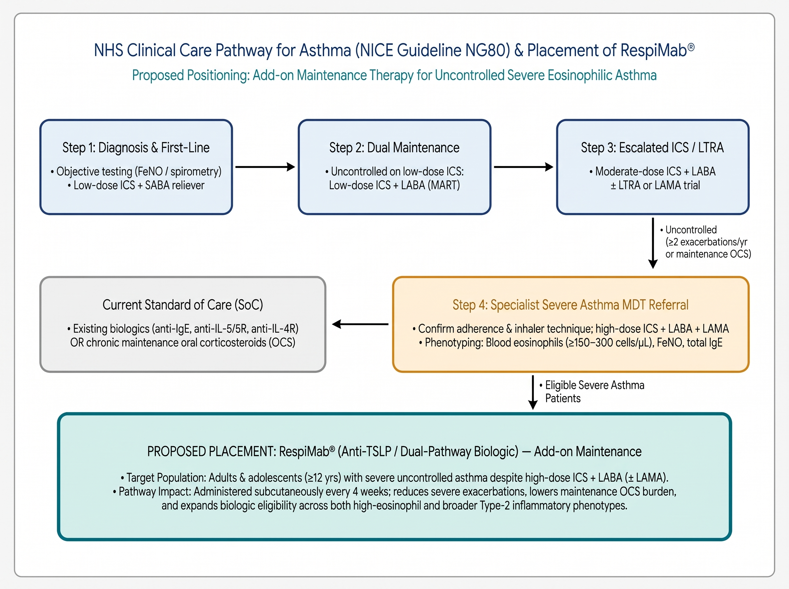
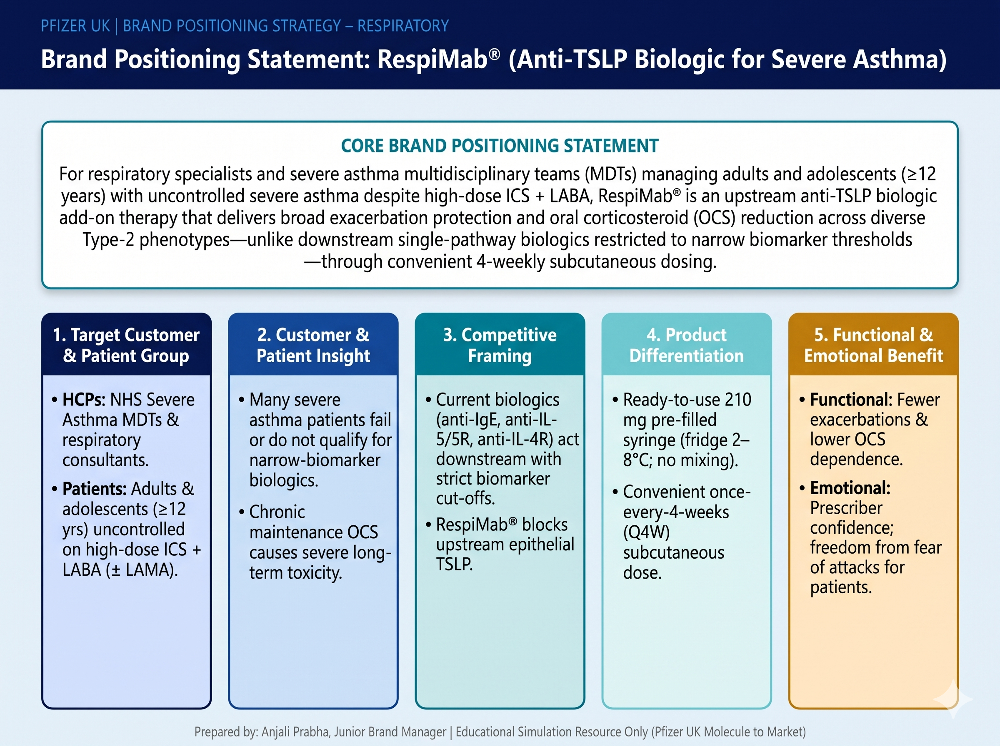

# 🧬 Lab-to-Market Life Sciences Portfolio

**Author:** Anjali Prabha  
**Academic Background:** B.Sc. (Hons.) Zoology, R.S. College, Magadh University | Former Research Intern, ICMR-RMRIMS Patna  

---

## 📌 Overview
This repository showcases an end-to-end **Lab-to-Market** portfolio built through four interconnected industry simulations on Forage. It demonstrates how a scientific discovery progresses from early laboratory validation to intellectual property protection, technology transfer, reimbursement appraisal, and pharmaceutical commercialisation.

---

## 🔬 1. Biology Research (Discovery & Validation)
- **Objective:** Design experimental workflows and analyse biological datasets to validate early-stage scientific findings.
- **Key Skills:** Experimental Design, Data Analysis, Scientific Documentation, Hypothesis Testing.

---

## 🛡️ 2. LifeArc — Intellectual Property (IP Protection)
- **Objective:** Act as an IP Analyst to evaluate early-stage inventions and safeguard scientific breakthroughs before external disclosure.
- **Key Deliverables:**
  - Evaluated Invention Disclosure Forms (IDFs) for novelty and industrial applicability.
  - Conducted prior art searches and assessed territorial patentability and Freedom-to-Operate (FTO) risks.

---

## 🤝 3. LifeArc — Technology Transfer (Commercialisation Strategy)
- **Role:** Technology Transfer Associate, Judd Street Innovations
- **Project:** Commercialisation assessment for Dr. Emily Carter’s non-invasive, blood-based early-stage cancer diagnostic tool (92% accuracy across a 200-patient proof-of-concept cohort).
- **Key Deliverables:**
  - Evaluated **Licensing**, **Spinout Formation**, and **Research Collaboration** using a multi-criteria Commercialisation Decision Matrix.
  - Recommended a **Phased Licensing Strategy**: a 12–18 month grant-funded Research Collaboration (Innovate UK, CRUK, Wellcome Trust) for multi-centre clinical validation, followed by an exclusive licensing agreement.
- **Deliverable File:** [`Commercialisation_Recommendation_Memo_Anjali_Prabha.docx`](./Commercialisation_Recommendation_Memo_Anjali_Prabha.docx)

---

## 📈 4. Pfizer UK — Molecule to Market (Health Economics & Go-to-Market)
- **Roles:** Junior Brand Manager & Therapy Area Specialist (Respiratory Portfolio)
- **Project:** Launch and reimbursement strategy for **RespiMab®** (investigational upstream anti-TSLP biologic for severe uncontrolled asthma).
- **Key Deliverables:**
  - **NICE Health Economics Submission:** Drafted Document B (Sections B.1.2 & B.1.3) aligned with NICE Guideline NG80 and created the NHS Clinical Care Pathway diagram (`clinical_pathway_diagram.png`).
  - **Brand Positioning:** Developed a 5-pillar differentiated brand positioning framework (`RespiMab_Brand_Positioning_Slide_2.png`) and delivered a pitch to marketing leadership.
  - **ABPI-Compliant Go-to-Market Strategy:** Built a customer segmentation plan (NHS Specialist Respiratory Consultants & Biologic Nurse Specialists), HCP conversation framework, and tracking metrics aligned with the ABPI Code of Practice and MHRA Blue Guide.
- **Deliverable Files:**
  - [`NICE_Company_Evidence_Submission_Task2_Anjali_Prabha.docx`](./NICE_Company_Evidence_Submission_Task2_Anjali_Prabha.docx)
  - [`Go_To_Market_Strategy_Presentation_Anjali_Prabha.docx`](./Go_To_Market_Strategy_Presentation_Anjali_Prabha.docx)

---

## 📊 Visual Deliverables
### NHS Clinical Care Pathway & Placement of RespiMab®

### RespiMab® Brand Positioning Framework

---

## 🛠️ Core Competencies Demonstrated
- **Scientific & Analytical:** Molecular & Clinical Pathway Mapping, Health Economics (HTA / NICE Appraisal), Diagnostic Performance Evaluation
- **IP & Commercialisation:** Invention Disclosure Review, Prior Art & FTO Assessment, Licensing & Deal Structuring
- **Pharma Strategy & Compliance:** Brand Positioning, Stakeholder Engagement, ABPI Code of Practice & MHRA Blue Guide Governance
